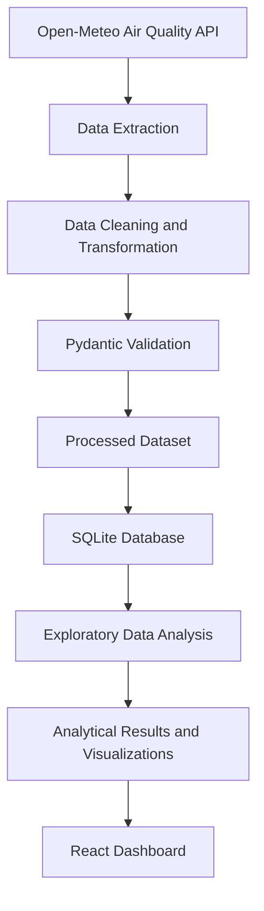

# 🇵🇰 Air Quality Monitoring of Five Pakistani Cities

### An ETL and Exploratory Data Analysis (EDA) Pipeline


---

## 📌 Table of Contents

- [Project Overview](#-project-overview)
- [Project Objectives](#-project-objectives)
- [Cities Monitored](#-cities-monitored)
- [Technologies Used](#-technologies-used)
- [ETL Pipeline](#-etl-pipeline)
- [Exploratory Data Analysis](#-exploratory-data-analysis)
- [Project Architecture](#-project-architecture)
- [Project Structure](#-project-structure)
- [Installation and Setup](#-installation-and-setup)
- [Future Improvements](#-future-improvements)

---

## 🌍 Project Overview

Air pollution is one of the major environmental challenges affecting urban areas in Pakistan.

**Air Quality Monitoring of Five Pakistani Cities** is a data engineering and analytics project designed to collect, process, validate, store, and analyze air quality data from five major Pakistani cities.

The project implements an **ETL (Extract, Transform, Load) pipeline** using Python and performs **Exploratory Data Analysis (EDA)** to discover patterns, relationships, and variations in air quality.

It also provides a web-based dashboard for presenting the collected information and analytical results.

## 🎯 Project Objectives

- Collect air quality information from an external data source.
- Extract and process environmental datasets.
- Clean missing, inconsistent, and invalid values.
- Validate data using Pydantic.
- Store processed data in a database.
- Perform statistical and exploratory analysis.
- Compare air quality across five Pakistani cities.
- Present analytical results through visualizations.

## 🏙️ Cities Monitored

The project focuses on the following five cities:

| City | Country |
|---|---|
| Lahore | Pakistan 🇵🇰 |
| Islamabad | Pakistan 🇵🇰 |
| Rawalpindi | Pakistan 🇵🇰 |
| Sialkot | Pakistan 🇵🇰 |
| Karachi | Pakistan 🇵🇰 |

## 🛠️ Technologies Used

| Technology | Purpose |
|---|---|
| Python | Core programming language |
| Pandas | Data manipulation and processing |
| Pydantic | Data validation |
| SQLAlchemy | Database interaction |
| SQLite | Data storage |
| FastAPI | Backend API |
| React | Frontend interface |
| Vite | Frontend development tooling |
| Matplotlib / other plotting libraries | Data visualization, where used |

## 🔄 ETL Pipeline

The project follows three major stages:

### 1. Extract

Air quality data is collected from the Open-Meteo Air Quality API.

### 2. Transform

The extracted information is processed using Python and Pandas.

Transformation includes:
- Data cleaning
- Handling missing values
- Data formatting
- Data validation
- Preparing structured datasets

### 3. Load

The processed data is stored using SQLite and SQLAlchemy for further analysis and retrieval.

### ETL Workflow



## 📊 Exploratory Data Analysis

The EDA component helps understand the collected air quality data through different analytical techniques.

The project includes analysis such as:

- Descriptive statistics
- City-wise air quality comparison
- Pollutant correlation analysis
- Hourly pollution trends
- Outlier analysis
- Data visualization

These analyses help identify patterns and differences in air quality across the selected cities.

## 🏗️ Project Architecture

The application is organized into two main components:

**Backend**
- Data extraction and processing
- Data validation
- Database management
- EDA operations
- API endpoints

**Frontend**
- Dashboard interface
- Data presentation
- Charts and visualizations
- Interaction with backend services

## 📁 Project Structure

```text
Air-Quality-Monitoring/
│
├── backend/
│   ├── app/
│   │   ├── config.py
│   │   ├── current_etl.py
│   │   ├── database.py
│   │   ├── eda.py
│   │   ├── etl.py
│   │   ├── main.py
│   │   ├── models.py
│   │   ├── scheduler.py
│   │   └── schemas.py
│   │
│   ├── data/
│   │   ├── raw/
│   │   └── processed/
│   │
│   ├── reports/
│   ├── scripts/
│   └── requirements.txt
│
├── frontend/
│   ├── src/
│   │   ├── App.jsx
│   │   ├── main.jsx
│   │   └── style.css
│   │
│   ├── package.json
│   ├── package-lock.json
│   └── vite.config.js
│
├── .gitignore
└── README.md
```

## ⚙️ Installation and Setup

### Prerequisites

Make sure you have installed:

- Python 3.x
- Node.js and npm
- Git

### 1. Clone the Repository

```bash
git clone https://github.com/Eman-Rasheed/Air-Quality-Monitoring.git
```

### 2. Backend Setup

```bash
cd Air-Quality-Monitoring/backend
```

Create a virtual environment:

```bash
python -m venv .venv
```

Activate it on Windows:

```bash
.venv\Scripts\activate
```

Install dependencies:

```bash
pip install -r requirements.txt
```

Run the FastAPI application:

```bash
uvicorn app.main:app --reload
```

### 3. Frontend Setup

Open another terminal:

```bash
cd Air-Quality-Monitoring/frontend
```

Install dependencies:

```bash
npm install
```

Start the development server:

```bash
npm run dev
```

*Note: These are standard development commands. The API entry point and startup requirements should be verified against the actual project configuration before treating this section as final.*

## 🚀 Future Improvements

- Add more Pakistani cities.
- Introduce historical air quality comparisons.
- Improve predictive analysis.
- Add more environmental indicators.
- Enhance dashboard functionality.

---

## 🎓 Project Information

**Project Title:** Air Quality Monitoring of Five Pakistani Cities

**Project Type:** Python Programming Course Project

**Project Focus:** ETL Pipeline Implementation and Exploratory Data Analysis

**Repository:** [GitHub Repository](https://github.com/Eman-Rasheed/Air-Quality-Monitoring)

---

*Developed as an academic project to explore data engineering, data processing, and environmental data analysis using Python.*
